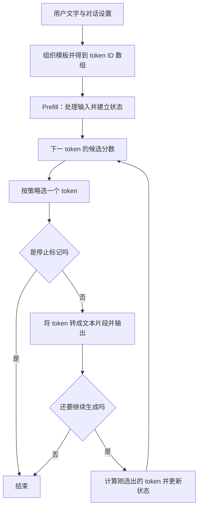

# 第 1 课：一次请求如何变成模型输出

日期：2026-10-13。建议先用 25–40 分钟读到第一个练习，再按反馈继续。适合有后端经验、尚未学习模型内部原理的读者。

本课只要求你能解释：**输入先变成 token ID；模型处理输入，得到下一个 token 的分数；程序选出一个 token，需要继续时再计算下一个。**

源码依据：`antirez/ds4@fc80bd695da76ee14bcb86820bf900a5cdfda806`。本课是静态阅读，未运行模型。源码已核查不等于学习者已经掌握；练习状态等待你的反馈。

## 1. 从你熟悉的请求处理开始

你写后端时，通常会把请求拆成：读取参数、准备输入、执行业务、返回结果。模型服务也有这些部分，其中的计算过程值得单独展开。

例如用户发来“解释一下 KV cache”。程序先组织模型需要的完整输入，再计算“接下来最适合出现哪些文本片段”。选出一段以后，以已有输入和刚生成的内容为条件，继续计算下一段，直到结束。这里描述的是本课选择的普通逐 token 生成路径。

**模型权重**暂时理解为训练得到的一大组数值参数。**推理引擎**负责用这些参数和当前输入做计算。你现在只需分清：模型文件提供参数，ds4 代码负责加载、计算和组织生成流程。权重内部如何表示，留到下一阶段。

进程先创建 `engine`，再为这次生成创建 `session`。可借用后端“服务对象”和“请求上下文”的区别：engine 管理模型/词表等资源，session 管理这段生成的状态。一个长期运行的服务可以复用已经加载的模型；不要把每次请求都必须重新读整个模型当成前提。

## 2. 先认识四个词

| 词 | 现在需要掌握的含义 | 常见误解 |
| --- | --- | --- |
| token / token ID | token 是模型使用的离散文本单位；ID 是词表中的编号 | 不固定等于一个汉字、单词或字节；ID 的大小也不代表含义大小 |
| logits | 对词表中各个“下一个 token 候选”的原始分数 | 还不是概率，也不是事实正确率 |
| prefill | 在本课的新 session 中处理完整输入，建立运行状态并得到首个输出的候选分数 | 不只是复制输入或填缓存；它包含模型计算 |
| decode | 生成阶段：以已处理的上下文为条件，继续生成后续 token | 这里的 decode 不等于把 token ID 转回文本；后者另称 detokenize |

输入不只包含用户问题。对话模板还会加入角色和模式标记，可能包括 system 内容。因此相同的用户字符串，不保证送进模型的 ID 数组相同。

为了说明数组形态，可以写成 `[a, b, c]`；这里的字母只是占位符，不是假定“解释一下”会切成三个 token。真实切分和 ID 必须由指定 tokenizer 产生。

## 3. 把模型内部暂时当作一个计算模块

本图限定：一个新 session、文本输入、普通非投机生成。已有会话的前缀复用以后单独学习。



关键点是：**第一个输出 token 的分数已经由 prefill 给出。**选择 token 和运行模型计算是两件事。

运行状态里有供后续计算复用的中间数据，其中包括以后要学的 KV cache。先记住它用于减少重复计算；这里不展开 attention，也不把 KV cache 当作“问题到完整答案”的缓存。

## 4. 今天只沿四个源码路标走

为了准确对应一条控制流，本课选择 DeepSeek V4 Flash、单机单 prompt、关闭 thinking、temperature > 0、无投机/视觉/分布式/SSD 的 session 路径。温度目前只理解为 token 选择策略的参数，不要求学习概率公式，也不要求在本机运行这套配置。

### 路标 A：先准备模型真正接收的输入

读 [ds4_cli.c 的 build_prompt:516–527](https://github.com/antirez/ds4/blob/fc80bd695da76ee14bcb86820bf900a5cdfda806/ds4_cli.c#L516-L527)。普通文字且无 prefix-file 时，调用 `ds4_encode_chat_prompt`。

本课只看三件事：

- `gen->system`：系统内容也属于模型输入。
- `gen->prompt`：用户提供的文字。
- `out`：构造出的 token 序列，不是最终回答。

在 [encode_chat_prompt:44309–44328](https://github.com/antirez/ds4/blob/fc80bd695da76ee14bcb86820bf900a5cdfda806/ds4.c#L44309-L44328) 可以看到角色标记被加入、正文调用 `bpe_tokenize_text`、最后追加 assistant 与 thinking 模式标记。BPE 的算法先不展开。

对应后端经验：这是带协议约定的输入组装。它会改变模型实际看到的内容，因此不只是展示层格式。

### 路标 B：处理输入，准备第一个输出的分数

读 [ds4_cli.c:569–586](https://github.com/antirez/ds4/blob/fc80bd695da76ee14bcb86820bf900a5cdfda806/ds4_cli.c#L569-L586)，抓住这一行即可：

```c
int sync_rc = ds4_session_sync(session, prompt, err, sizeof(err));
```

输入是 session 和 token 数组。对本课的新 session，它触发 prefill；成功后，session 中保存了处理进度、中间状态和下一 token 的 logits。调用者先处理错误，再进入生成循环。

`sync` 名字更通用：以后已有历史时，它还要处理前缀一致性和复用。今天不要把“每次 sync 都完整重算”记成规则。需要核查内部赋值时再看 [Flash fresh prefill:77524–77584](https://github.com/antirez/ds4/blob/fc80bd695da76ee14bcb86820bf900a5cdfda806/ds4.c#L77524-L77584)。

### 路标 C：先选 token，再决定是否继续计算

读 [ds4_cli.c:605–653](https://github.com/antirez/ds4/blob/fc80bd695da76ee14bcb86820bf900a5cdfda806/ds4_cli.c#L605-L653)。先跳过 `eval_speculative` 分支，只跟普通 `else`。

下面是保留顺序的教学伪码，省略错误处理、进度、计时和高级分支，不能直接执行：

```text
处理输入，得到 session 中的 logits
只要没有到输出上限、也没有收到中断：
    从已有 logits 选择一个 token
    如果是停止标记，结束
    将 token 转成文本片段并输出
    已输出数量加一
    如果已经达到上限，不再计算下一步
    将刚选中的 token 送回模型，更新状态和下一 token 的 logits
```

`ds4_session_sample` 读取已有的 `s->logits` 来选 token；它不是完整模型 forward。[实现:77719–77723](https://github.com/antirez/ds4/blob/fc80bd695da76ee14bcb86820bf900a5cdfda806/ds4.c#L77719-L77723)

`ds4_session_eval` 才推进刚选中的 token，对后续预测做准备。内部模型计算更新 `s->logits`，并把 token 加入处理历史。[普通 Flash eval:78831–78853](https://github.com/antirez/ds4/blob/fc80bd695da76ee14bcb86820bf900a5cdfda806/ds4.c#L78831-L78853)

### 路标 D：输出文本与计算模型分开看

同一段代码中的 `ds4_token_text` 把 ID 转成字节片段，`token_printer_write_text` 与 `fflush` 负责输出。一个 token 不保证单独组成完整中文字符或单词。

这段入口是 CLI，所以写 stdout。以后读 server 时，再加上 HTTP/SSE 与缓冲层。不能从“收到几个网络消息”直接推出“生成几个 token”。

## 5. 先在脑中跑一次循环

假设 prefill 已成功、上下文空间足够、没有中断或停止 token，输出上限是 3。这里把三个生成的 token 记为 A、B、C，不赋予假造的真实词表 ID。

| 时刻 | 程序做什么 | 已输出什么 |
| --- | --- | --- |
| 1 | prefill 处理输入，得到 A 所在候选集合的分数 | 暂无 |
| 2 | 从分数中选择 A，输出 | A |
| 3 | eval A，得到下一 token 的分数；选择并输出 B | A、B |
| 4 | eval B，得到下一 token 的分数；选择并输出 C | A、B、C |
| 5 | 达到上限，不再 eval C | 完成 |

在这条明确的代码路径中，3 个输出只需要 2 次后续单 token eval。这个例子是为了理解“先有分数，再选 token”；不要推广成所有后端、退出方式和投机路径的通用调用计数。如果要继续采样到 EOS，就还需要获得预测 EOS 的分数。

输出上限也不是承诺输出长度。源码在打印前检查停止标记，还会按剩余 context 空间缩小预算。[预算处理:588–591](https://github.com/antirez/ds4/blob/fc80bd695da76ee14bcb86820bf900a5cdfda806/ds4_cli.c#L588-L591)

## 6. 联系真实使用体验

“等很久才开始输出”和“开始后生成很慢”可以发生在不同阶段。输入变长通常增加 prefill 的工作；输出更长通常需要更多后续生成步骤。长上下文也可能影响每一步生成的成本，不能把两段性能完全割裂。

真正的首 token 等待还可能包含排队、输入处理、首次加载、GPU 准备和网络开销。源码中 prefill 的局部计时不等于用户看到的全部等待时间。先会区分阶段，以后再定义 TTFT、吞吐和尾延迟。

## 7. 今天只回答一个问题

假设输入已经完成 prefill，上下文空间足够，没有中断；输出上限设为 1，而且选中的 token 不是停止标记。

**第一个输出 token 的分数从哪里来？打印它之后，这条普通路径还需要调用 `ds4_session_eval` 吗？为什么？**

请先用自己的话回答，或者画出“处理输入 → 选一个 → 输出 → 是否继续”的顺序。无需使用专业术语。不要求马上继续下一课；根据回答决定是回看循环，还是展开模板/tokenizer 与权重数据。

## 阅读边界与后续入口

- 已由源码确认：输入构造、prefill 后选择首 token、普通生成循环、停止/上限与输出的先后关系。本课未产生任何运行性能结果。
- 学习者理解：待练习反馈；不因已生成课件就标记为掌握。
- 暂未展开：BPE 合并、tensor 数学、attention、KV 的具体结构、GPU kernel、量化、MoE、投机解码。
- 路径边界：temperature=0 的默认 CLI 会分流到 `ds4_engine_generate_argmax`，不能把本课逐行调用链直接套到 PGX 的 greedy 配置。[分流:1240–1271](https://github.com/antirez/ds4/blob/fc80bd695da76ee14bcb86820bf900a5cdfda806/ds4_cli.c#L1240-L1271)
- 下一步：先解释本课的小循环，再根据卡点阅读 `encode_chat_prompt` 的模板/分词，或进入权重和 tensor。回到 [学习路线](README.md)。

English recap: Prefill processes the input and produces scores for the first output token. Sampling selects a token from those scores. If generation continues, the model evaluates that token to prepare scores for the next one.
