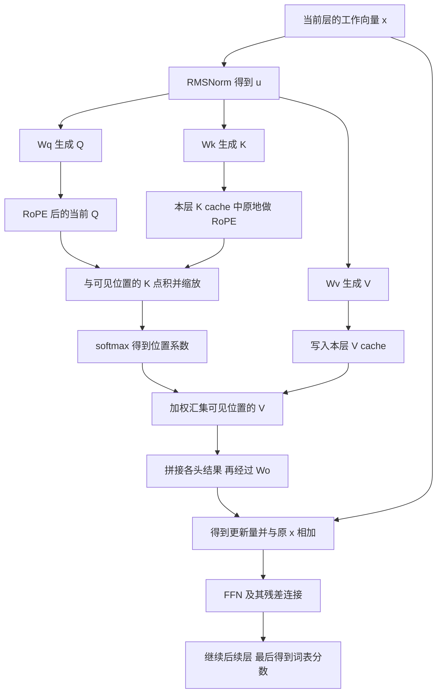

# QKV 个人学习复盘与源码调试路线

整理日期：2026-10-16。适用于有后端开发经验、正在用 Mac 上的 TinyStories 15M 和 llama2.c 学习推理的你。每次只读一小节，完成一个计算或观察，再继续。

从这次问答判断，你目前最需要补齐的是一条完整的数据链：**每个数组从哪里来，为什么需要它，怎样计算，结果交给谁，以及它会保存多久。** 矩阵乘法和维度规则是其中需要动手练习的部分。仅记住 Query、Key、Value 的中文解释，还不足以读懂程序。

下面先用你的提问定位缺口，再沿用“小”和“猫”的例子，把参数、计算和输出去向接起来，最后对应到实际源码。个性化判断属于根据问答作出的教学推断；手算数字是教学设定；源码事实另附固定版本链接。本文没有新增推理性能实验。

第一次阅读先到“先掌握一个反复使用的计算规则”为止，再做文末指定的 Wo 练习。完整 attention 算例、真实模型对照和后续路线可以分几次阅读；后面的名词不需要现在全部掌握。

## 从提问中定位理解缺口

### 已经能够确认的进展

你已经实际启动过调试，观察了 `token = 1`、`pos = 0`、`next = 9038` 和终端中的输入回显。这说明可以把学习建立在真实程序上。

你随后问“Q 跟 K 要想比较的话，它们权重的行数是不是一定要相等”，说明你已经开始把**矩阵形状与运算能否成立**联系起来。你也持续追问结果的用途，而不满足于看到一个数字。

这些是有依据的进展。是否已经能独立算出完整 attention，还需要下面的练习确认；助手讲过一遍不能直接记为你已掌握。

### 具体卡点与对应证据

| 你的提问或反馈 | 暴露出的理解断点 | 接下来补什么 |
| --- | --- | --- |
| “run.c 900 多行，只 debug 一个位置能学到什么” | 对此前教学范围和深度不满意；这是对教学的反馈，不能据此判断你的掌握程度 | 每次追踪一个结果从输入到输出的完整过程 |
| “这个比较是什么意思？怎么比较的？” | “比较”这个词没有落到确定的运算 | 用一组实际数字完成对应相乘、求和和缩放 |
| “为什么要 Q 和 K 做比较？” | 知道操作以后，还需要理解它解决的问题 | 当前位置如何根据自身状态，给不同历史位置分配贡献比例 |
| “权重的行数是不是一定要相等？” | 正在建立维度约束，但单头和多头尚需区分 | 矩阵列数与输入长度、行数与输出长度；真正做点积的向量长度 |
| “为啥要混合 V？混合出来的 V 又要做什么？” | 分数与被读取的数据，以及结果的去向没有分清 | 位置权重 → 加权汇集 → 输出投影 → 更新当前位置 |
| “为什么得到了 4 个数？” | 矩阵作为多条计算规则的直觉还不稳定 | 同样两个输入，分别执行四条规则，得到四个结果 |
| “Wo 又是从哪来的呀？” | 模型设计、训练、推理这三个阶段的职责尚未完全分清 | 设计确定形状；训练学习数值；推理读取参数并计算中间结果 |
| “把 WQ、WO、WK、WV 这几个的形状列出来” | 多个名称需要放进同一张数据流图中才能对齐 | 固定一组数字与统一记号，避免不断更换例子 |

这些问题集中指向三个当前优先级最高的基础：**对象身份、形状与运算、目的与去向。** 至于你是否仍困惑“浮点数组为什么能表达语言”，现有追问不足以确定，需要用复述再检查，不能直接给你贴上“数学基础差”的标签。

### 之前的讲解需要改进的地方

“Q 负责查询，K 负责匹配，V 负责内容”可以帮助记名字，但没有说明任何一个数怎么来。“输出投影”也只是操作名称，不能代替逐行计算。之后的讲解应先给输入、参数、运算和输出，再引入名称。

例子中引用了已有的 V，却没有在你这次粘贴的片段里列出 Wv；讲 Wo 时又突然从两个数变成四个数。独立阅读时，这些地方会形成断点。本文补齐 Wv，并明确每一步的形状。

还有一个应修正的数值示范：之前把 Q 从 `[2, 1, 0]` 换成 `[0, 1, 2]`，两项点积分数从 `[5, 4]` 变成 `[9, 8]`。两者只是同时增加了 4，缩放后的差值也相同，所以 **softmax 权重没有改变**。这不足以示范“读取比例改变”。后面改用 `[0, 1, 0]`，让你真正看到比例和汇集结果发生变化。

## 先把数据的身份分清

### 借用后端开发经验理解一次计算

可以先把某一层看成一个接收数组、使用参数、访问缓存、返回新数组的函数。需要区分三类对象：

| 对象 | 从哪里来 | 在普通推理中的变化 |
| --- | --- | --- |
| 模型参数，例如 Wq、Wk、Wv、Wo | 训练后保存到模型文件，加载到内存 | 同一层在各个位置反复使用同一套参数；不同层各有自己的参数 |
| 工作数据，例如 x、u、Q、混合结果 m | 根据当前输入执行计算 | 随位置、层和输入状态变化，内存可能反复复用 |
| KV cache | 已处理位置计算出来的 K、V | 当前序列继续生成时增加有效位置，供后续位置读取 |

缓存保存的是计算结果。这里的 Key 和 Value 来自 attention 的术语，不能按普通字典中“精确匹配一个 key 后返回一条 value”的方式理解；这段代码会给所有可见位置打分，再汇集它们的 V。

“参数”和“注意力权重”都可能被简称为“权重”，但需要分开：**Wq 等是加载的模型参数；`att[t]` 是这次计算临时产生的某个位置的贡献系数。**

在当前源码中，参数放在 `TransformerWeights`，工作数据与缓存放在 `RunState`；加载流程通过 `read_checkpoint` 和 `memory_map_weights` 确定参数指针。见固定版本的 [结构体](https://github.com/karpathy/llama2.c/blob/350e04fe35433e6d2941dce5a1f53308f87058eb/run.c#L29-L75)与[模型加载](https://github.com/karpathy/llama2.c/blob/350e04fe35433e6d2941dce5a1f53308f87058eb/run.c#L111-L168)。

### 一个浮点数组怎样表达信息

最初的 token ID 只是词表编号。Embedding 表中，这个编号对应一行训练得到的数；程序复制这一行，作为当前 token 的初始工作向量 x。之后的计算不断更新这组数。

可以把这组数理解为模型内部使用的数值表示。它之所以对任务有用，是因为训练同时调整了这些表示和处理它们的参数，使模型的预测逐渐改善。不能随意给某个下标命名为“猫的大小”或“语法属性”，也不能从一个单独的数判断模型懂了什么。

需要先分清：`token` 是编号，`pos` 是序列位置，`x[i]` 是工作数组的一个浮点分量。编号 9038、位置 1、数组长度 288 描述的是三件不同的事。前两者与 Embedding 的关系见[前一篇学习记录](02-token-embedding-rmsnorm.md)。

### 四张参数矩阵从哪里来

模型设计先规定数据尺寸，例如输入向量有几个数、每个头的 Q 和 K 有几个数，由此确定矩阵形状。训练再调整矩阵里的具体数值：预测下一个 token，计算预测误差，通过反向传播和优化器更新参数，反复进行后保存模型。

你现在运行的是推理程序：它加载已有参数，使用这些参数算出 Q、K、V 和更新量。**Wo 不由本次的 m 临时生成；Wq 也不由本次的 Q 反推出来。** 训练细节可以后补，目前先掌握“形状的来源”和“数值的来源”这两个区别。

## 先掌握一个反复使用的计算规则

本文统一使用“矩阵行数 × 列数”，并把输入看成列向量：

```text
W 有 d 行、n 列，输入 x 有 n 个数
每一行分别与整个 x 对应相乘，再相加
每行得到一个输出，所以最终输出 d 个数

输出[i] = W[i,0]×x[0] + ... + W[i,n-1]×x[n-1]
```

因此，列数必须接上输入长度，行数决定输出长度。输入只有两个数，也可以使用四组不同参数计算四个结果；这些结果仍然来自原来的两个数，没有凭空产生四份独立信息。

当前 [`matmul`](https://github.com/karpathy/llama2.c/blob/350e04fe35433e6d2941dce5a1f53308f87058eb/run.c#L217-L229) 正是这个过程，省略并行编译指令后是：

```c
for (int i = 0; i < d; i++) {       // 一行参数，负责一个输出
    float val = 0.0f;
    for (int j = 0; j < n; j++) {   // 遍历这一行和全部输入
        val += w[i * n + j] * x[j];
    }
    xout[i] = val;                 // 这一行算完，写入一个结果
}
```

`w[i * n + j]` 是把二维矩阵平铺存放后，第 i 行、第 j 列的元素。后面生成 Q、K、V，以及用 Wo 处理 m，都使用这个规则。在别的库中可能看到转置后的存储约定，阅读时要先核对形状，不能只记住表面上的行列顺序。

## 用同一个例子走完 attention

这里把“小”和“猫”设为两个教学位置，不声称真实 tokenizer 会这样切分中文。只看一个头，省略位置编码；Q、K 长 3，V 长 2，用来显示不同数据各自受什么尺寸约束。它是可手算的例子，并非 TinyStories 的实际结构或参数。

本节从 RMSNorm 后的输入 u 开始。x 是该层原来的工作向量，u 是归一化后的副本；本节给定 u，不把它冒充为原始 x。`x → u` 的过程留在 RMSNorm 小课单独验证。

### 先说明这一步要解决什么问题

处理“猫”这个位置时，模型要让它的后续计算能利用可见上下文。为此，需要完成两件事：算出每个可见位置在这次读取中的贡献比例，以及把那些位置的数据按比例汇集起来。

Q 和 K 提供一种可学习的打分方式：当前位置的 Q 与各位置的 K 共同决定分数。这样，同一份历史 K 面对不同的当前 Q，可能得到不同的相对分数。“需要什么”和“提供什么特征”是对它们作用的解释；实际程序只计算数组，没有执行文字查询或人工语义规则。

Wq、Wk 分开学习，可以让发起读取与供匹配的表示采用不同变换。Q/K 点积是这里采用的设计，不是所有信息汇集方法都必须遵守的唯一形式。

### 摆齐输入和全部参数

```text
u小 = [1, 2, 3, 4]
u猫 = [2, 1, 0, 3]

Wq = [ [1, 0, 0, 0],        Wk = [ [0, 1, 0, 0],
       [0, 1, 0, 0],               [1, 0, 0, 0],
       [0, 0, 1, 0] ]             [0, 0, 0, 1] ]

Wv = [ [1, 0, 1, 0],        Wo = [ [1,  0],
       [0, 1, 0, 1] ]             [0,  1],
                                  [1,  1],
                                  [1, -1] ]
```

Wq、Wk、Wo 延续聊天中的教学参数；Wv 是为使本篇可独立复算而补充的一组教学参数，能产生聊天中已有的两份 V。

| 参数 | 输入 | 形状 | 输出 |
| --- | --- | --- | --- |
| Wq | u 的 4 个数 | 3 × 4 | Q 的 3 个数 |
| Wk | u 的 4 个数 | 3 × 4 | K 的 3 个数 |
| Wv | u 的 4 个数 | 2 × 4 | V 的 2 个数 |
| Wo | m 的 2 个数 | 4 × 2 | Δx 的 4 个数 |

### 先得到用于打分和汇集的数组

处理“小”时计算并留下 K、V：

```text
K小 = Wk × u小
    = [0×1+1×2+0×3+0×4,
       1×1+0×2+0×3+0×4,
       0×1+0×2+0×3+1×4]
    = [2, 1, 4]

V小 = Wv × u小
    = [1×1+0×2+1×3+0×4,
       0×1+1×2+0×3+1×4]
    = [4, 6]
```

现在处理“猫”。同一层仍使用同样的三张矩阵，只是输入换成 u猫：

```text
Q猫 = Wq × u猫 = [2, 1, 0]
K猫 = Wk × u猫 = [1, 2, 3]
V猫 = Wv × u猫 = [2, 4]
```

例如 `V猫[0] = 1×2 + 0×1 + 1×0 + 0×3 = 2`。你可以按同一规则补算另外各项。此时需要的是当前 Q，以及两个可见位置各自的 K、V；“小”的历史 Q 不参与这次读取。

### 所谓比较就是算出两个分数

点积是两个等长数组对应相乘后求和：

```text
Q猫 · K小 = 2×2 + 1×1 + 0×4 = 5
Q猫 · K猫 = 2×1 + 1×2 + 0×3 = 4
```

这时还没有选择一个唯一位置。分数 5 比 4 大，只表示按这次 Q/K 的计算，“小”获得较高分数；不能据此解释成语义理解更正确，也不是数组相等判断。

你问到的维度要求正体现在这里：每个 Q 分量需要一个对应的 K 分量。**真正参与同一次点积的 Q 和 K 必须等长。** 在这个单头例子中，Wq、Wk 都有 3 行。多头时需要先分头，再核对每一对向量；如果多个 Q 头共享一个 K 头，整张 Wq、Wk 的行数就不必相同。

接着除以 Q/K 的长度的平方根：

```text
score小 = 5 / √3 ≈ 2.886751
score猫 = 4 / √3 ≈ 2.309401
```

缩放用的是 3，而不是可见位置数 2，也不是 V 的长度 2。它用于控制点积的数值尺度。真实源码对应 [294–300 行](https://github.com/karpathy/llama2.c/blob/350e04fe35433e6d2941dce5a1f53308f87058eb/run.c#L294-L300)，其中除数使用实际的 `head_size`。

### softmax 把分数转换成贡献比例

softmax 先取指数，再除以指数之和。e 是约等于 2.71828 的数学常数；计算器中的 `exp(z)` 就是 e 的 z 次方。

为避免数值过大，源码先从所有分数中减去最大分数。这样得到的比例与直接取指数相同。本例为：

```text
减去最大值： [0, -0.577350]
分别取指数： [1,  0.561384]
指数之和：   1.561384

a小 = 1        / 1.561384 ≈ 0.640457
a猫 = 0.561384 / 1.561384 ≈ 0.359543
```

两个系数为正，总和约为 1。这里的两个元素对应**两个上下文位置**，并不表示“下一个输出 token 是小或猫”的概率。实现见 [`softmax`](https://github.com/karpathy/llama2.c/blob/350e04fe35433e6d2941dce5a1f53308f87058eb/run.c#L195-L215)，attention 在 [304 行](https://github.com/karpathy/llama2.c/blob/350e04fe35433e6d2941dce5a1f53308f87058eb/run.c#L304)调用它。

### 用这些比例汇集 V

前面的系数只决定各位置如何参与，还没有将这些位置的数据带入结果。现在逐项计算：

```text
m[0] = a小×V小[0] + a猫×V猫[0]
     ≈ 0.640457×4 + 0.359543×2 ≈ 3.280915

m[1] = a小×V小[1] + a猫×V猫[1]
     ≈ 0.640457×6 + 0.359543×4 ≈ 5.280915

m ≈ [3.280915, 5.280915]
```

m 是新的 attention 汇集结果，原来缓存中的 V小、V猫仍然保留。可见位置即使增加到 10 个，只要每份 V 仍长 2，这次汇集结果就仍长 2。这样可以把数量变化的上下文汇集成尺寸固定的输入，交给后续模块。

加权求和允许多个位置共同参与，也会压缩信息；它不是无损保存整个上下文。源码中的 [`xb[i] += a * v[i]`](https://github.com/karpathy/llama2.c/blob/350e04fe35433e6d2941dce5a1f53308f87058eb/run.c#L307-L318)就是逐项累加这一过程。

### Wo 把汇集结果变成可以加入主通路的更新量

原来的 x 长 4，m 长 2。Wo 的四行分别处理 m 的全部两个数：

```text
Δx[0] = 1×m[0] + 0×m[1]  ≈ 3.280915
Δx[1] = 0×m[0] + 1×m[1]  ≈ 5.280915
Δx[2] = 1×m[0] + 1×m[1]  ≈ 8.561830
Δx[3] = 1×m[0] - 1×m[1]  = -2

Δx ≈ [3.280915, 5.280915, 8.561830, -2]

x新 = [x[0]+3.280915,
       x[1]+5.280915,
       x[2]+8.561830,
       x[3]-2]
```

这一步与生成 Q、K、V 的乘法遵守完全相同的规则。Wo 的用途也不只在改变长度：它学习如何组合汇集结果，将其变成适合主通路的更新量。即使输入输出都长 288，这个组合仍然有作用。

相加用的是保留下来的原始 x；u 只是计算 Q/K/V 使用的归一化版本。这种把更新量加回原数据的操作叫 residual connection，残差连接。当前源码在 [322 行完成 Wo 投影，325–326 行相加](https://github.com/karpathy/llama2.c/blob/350e04fe35433e6d2941dce5a1f53308f87058eb/run.c#L322-L326)。

更新后的 x 会继续经过本层 FFN 和后续各层。所有层完成后，再做最终归一化与词表投影，得到每个候选 token 的分数 logits；生成循环随后决定使用下一个 prompt token，还是从 logits 选择新 token。**attention 的汇集结果距离最终 token 选择之间，还有这些计算。** 见 [FFN 与最终输出](https://github.com/karpathy/llama2.c/blob/350e04fe35433e6d2941dce5a1f53308f87058eb/run.c#L330-L361)和[生成循环](https://github.com/karpathy/llama2.c/blob/350e04fe35433e6d2941dce5a1f53308f87058eb/run.c#L747-L769)。

### 只换一个 Q 看读取比例怎样变化

保持两份 K、V 不变，将当前 Q 作为教学干预改为 `[0, 1, 0]`，重新计算：

| 计算项 | 原来的 Q 为 `[2,1,0]` | 换成 `[0,1,0]` |
| --- | --- | --- |
| 两个点积分数 | `[5, 4]` | `[1, 2]` |
| 缩放再 softmax 后的系数 | 约 `[0.640457, 0.359543]` | 约 `[0.359543, 0.640457]` |
| 汇集结果 m | 约 `[3.280915, 5.280915]` | 约 `[2.719085, 4.719085]` |

同一份历史数据可以按不同的系数被读取，当前的后续计算也因此改变。这里为了观察因果关系直接给定另一个 Q；正常运行时 Q 由输入和 Wq 计算。

还可以反过来做一个思想练习：只改 V，保持 Q、K 不变。此时位置系数不变，汇集结果可能改变。例如只把 `V小[0]` 增加 1，`m[0]` 就增加 `a小`；多个位置的改动也可能互相抵消。这样就能分清“算贡献比例”和“提供参与汇集的数据”两种职责。

## 回到 TinyStories 的真实尺寸和源码

阅读基准是 `sources/llama2.c` 提交 `350e04fe35433e6d2941dce5a1f53308f87058eb`。本次读取本地模型头，确认仍是 `dim=288`、`hidden_dim=768`、6 层、6 个 Q 头、6 个 KV 头、词表 32000、序列容量 256；模型身份见 [model.lock.json](../../experiments/tiny-inference/model.lock.json)。

| 对象 | 手算例子 | 当前模型的一层 |
| --- | --- | --- |
| x、u | 各 4 个数 | 各 288 个数 |
| Wq、Wk | 各 3 × 4 | 各 288 × 288 |
| Wv | 2 × 4 | 288 × 288 |
| 每头的 Q、K、V | 3、3、2 个数 | 各 48 个数，共 6 个头 |
| 每头汇集结果 | 2 个数 | 48 个数；6 个头拼成 288 个数 |
| Wo | 4 × 2 | 288 × 288，处理所有头拼接的结果 |
| 更新量 Δx | 4 个数 | 288 个数 |

手算例子允许 V 与 Q/K 长度不同，用来理解运算约束；当前 `run.c` 用同一个 `head_size` 处理各头的 Q/K/V，不能直接把这个例子的尺寸当作模型配置填进去。

真实代码还在投影后，对 Q、K 做 RoPE 位置变换，再计算点积；V 不参与这一变换。手算例子省略了它，后续应单独学习。当前 RoPE 按两个分量一组处理，也不能直接套用手算例子中长度为 3 的头。见 [`forward` 的投影、位置变换与分头](https://github.com/karpathy/llama2.c/blob/350e04fe35433e6d2941dce5a1f53308f87058eb/run.c#L249-L300)。



图里的 K/V cache 包含同一层之前位置和当前位置的数据。源码先让 K/V 指针指向缓存槽，再直接写入投影结果；RoPE 会在这个槽里原地更新 K，不需要另一次拷贝。

## 在调试器中按计算阶段看变量

继续使用现有配置 `TinyStories：QKV 从哪里来`。它在 `run.c:260` 停住，条件是 `pos == 1 && l == 0`，对应处理第一个普通输入片段 `" Once"` 的第 0 层；之前的位置是 BOS。配置来源见 [.vscode/launch.json](../../.vscode/launch.json)，操作入口见[小模型动手课](../../experiments/tiny-inference/README.md)。

**高亮行通常尚未执行；相同变量名也可能在后面被复用来存别的结果。** 先确认所处阶段，再解释数组内容。下面是分次学习的检查点，不要求一次全部完成。

| 停止位置 | 此时可以看什么 | 这一小步回答什么 |
| --- | --- | --- |
| 260 行，Q 投影前 | `dim`、`kv_dim`、`head_size`、`s->xb[0]`、`w->wq[0]` | 输入和参数分别在哪里；此时 `s->q` 还不是当前投影的结果 |
| F11 进入 `matmul`，到 225 行 | `n`、`d`、`i`、`j`、`val`、`w[i*n+j]`、`x[j]` | 一次乘加怎样积累成一个输出；227 行写入之后该分量才完整 |
| 265 行，三次投影后 | `s->q[0]`、`s->k[0]`、`s->v[0]` | 相同输入经过三组参数得到三个数组；Q/K 接着还要经过 RoPE |
| 304 行，加条件 `h == 0`；再 F10 到 307 行 | `att[0]`、`att[1]` 及二者之和 | 同一数组怎样由两个位置分数变成两个系数；此时 V 汇集还没完成 |
| 316 行，加条件 `h == 0 && t == 0 && i == 0` | `a`、`v[0]`、`xb[0]`；执行这一行后再看 `xb[0]` | 第一个位置对第一个输出分量贡献了多少 |
| 322 行，再执行 Wo 调用到 325 行 | 调用前的 `s->xb[0]`，调用后的 `s->xb2[0]`，以及尚未相加的 `x[0]` | 区分汇集结果、更新量和原工作向量 |

表中 `forward` 内的后续断点都保留 `pos == 1 && l == 0`；`h`、`t`、`i` 仅能在对应循环作用域内使用。`matmul` 内没有 `pos`、`l`，这里从 260 行用 F11 进入，不直接照搬条件到它的断点中。

若 Debug Console 显示 commands mode，可以用 `? s->xb[0]` 查看表达式。进入 `matmul` 后，局部变量 `x` 指向本次传入的数组；从 260 行进入时，它是外面的 `s->xb`，不要与 `forward` 的主通路 `x` 混为一谈。

`s->xb` 尤其容易误读：260 行它是归一化输入，322 行它是各头汇集结果，之后还会被 FFN 复用。K/V 指针则指向本层本位置的缓存槽；分头循环里的局部 `k`、`v` 指向正在被读取的那个历史位置和头。

已有的本机首 token 调试证据见 [reports/tiny-inference](../../reports/tiny-inference/README.md)。本篇给出的是下一轮观察路线，不把这些待完成练习标记为你的实测结果。

## 接下来按什么顺序学习

### 先补齐这一条计算链

下一轮按以下顺序推进，每次只交付一个可以检查的结果。遇到问题就在该步停留，不以读完篇幅计进度。

开始前先花 5 分钟，给 `Wq`、`Q`、`att`、`K cache` 标明“从文件加载的参数”“本次计算的结果”或“保留的历史结果”。能说出它们各自的来源，再进入第 1 项；说不清就先回看数据身份一节。

| 次序 | 本次只解决的问题 | 动手与通过条件 |
| --- | --- | --- |
| 1，约 15–20 分钟 | 两个输入为什么能得到四个输出 | 不看答案，用本篇 Wo 算出四项 Δx；指出每项对应哪一行；解释四个输出仍依赖那两个输入 |
| 2，约 20–30 分钟 | Q/K 为什么要等长，V 为什么可以不同 | 写出四张矩阵形状；自己算出一份 Q、K、V；在 `matmul` 中指出输入、参数、输出和循环边界 |
| 3，约 20–30 分钟 | 分数怎样变成读取比例 | 算出 `[5,4]` 的缩放和 softmax；只换 Q 后预测比例变化，再核算；解释为什么 `[9,8]` 得到相同比例 |
| 4，约 20–30 分钟 | 汇集结果如何影响当前状态 | 算出 m 和 Δx，画出原 x 保留到残差相加的路径；说明改 V 会影响哪一步 |
| 5，约 20–30 分钟 | 为什么保存 K/V，缓存按什么组织 | 在当前模型说明 layer、position、head 三个维度；找到一次历史 K/V 读取，并解释为什么不需要历史 Q 来算当前输出 |
| 6a，约 20–30 分钟 | RMSNorm 怎样得到一个输出分量 | 只观察平方和、均值、缩放参数和 `xb[0]`，确认原 x 留在原处 |
| 6b，约 20–30 分钟 | 最终工作向量怎样变成下一个 token | 从最后一层结束处跟到最终归一化、32000 项 logits 和选择分支；当次只标出 FFN 的输入输出，详细计算另开一课 |

完成这条计算链后，再深入多头拆分和 RoPE；GQA 留到 KV cache 已经清楚之后。FFN 学习时先看 288→768→288 的形状与残差，再补 SiLU 和门控。暂时不需要先完成整门线性代数、微积分或 CUDA 课程。

如果对参数来源仍不踏实，可以插入一次极小的训练示例：观察一个参数如何因预测误差而更新。其目标仅是理解“学习参数”的含义，之后再决定是否深入梯度和反向传播。

### 每周 5 到 8 小时怎样安排

可以将 2–3 小时分散到上述小课，用约 1.5 小时做两次完整复算或源码追踪，再用 1 小时整理自己的复述与观察。剩余时间用于最难的一处补课，或阅读一条与本周问题有关的上游讨论。进度以通过条件为准，不要求一周讲完所有主题。

每个概念采用同一个顺序：先说要解决什么问题，列出输入和参数，预测输出形状，手算一个分量，观察对应代码，最后说明结果去哪。这个顺序直接回应了你在本次对话里反复提出的问题。

### 再连接到 AI Infra 研究

| 理解基础后再学 | 它将帮助你提出什么问题 |
| --- | --- |
| KV cache 的内容、有效长度与分配容量 | 上下文增加时，缓存和读取工作怎样增长；缓存如何复用 |
| 单步 decode 与批量 prefill | 为什么相同计算在不同阶段有不同性能表现 |
| 多头与 GQA | 减少 KV 头怎样改变缓存尺寸，Q 头怎样共享 K/V |
| FP32 与量化 | 参数怎样压缩、在哪一步恢复或参与低精度计算、数值误差影响哪里 |
| CPU/GPU 执行与访存 | 某个优化减少的是运算、数据搬运还是调度成本 |
| ds4 与 llama.cpp 的实现对照 | 同一个概念在两套实现里有哪些布局、缓存和执行路径差异 |

Mac 继续负责手算、调试和形成可检验问题；PGX 使用固定版本验证实际硬件行为。理解 TinyStories 的计算路径能帮助阅读大模型实现，但不能直接推出 ds4 在 GB10 上的性能或效果。

你已提出过“能否预先缓存第一层 RMSNorm”这一候选想法。等输入、参数和残差关系清楚后，再回到[前一篇的假设与验证边界](02-token-embedding-rmsnorm.md#为什么不在模型出厂时全部归一化)，先检查正确性和额外内存，再讨论是否值得测性能。

## 如何检查这次是否真的理解

先不翻正文，回答下面的问题；卡在哪一题，就回到对应小节。

1. Wo 的形状是谁规定的，里面的数是谁学到的？推理时什么会变化？
2. Wq 为 3×4、输入有 4 项时，输出为什么有 3 项？一个输出用了多少个输入分量？
3. Q 和 K 各长 3，但 V 长 2，哪一步要求等长，最后 m 有几项？
4. `[0.64, 0.36]` 的两个元素对应什么？能否把它当作两个候选 token 的生成概率？
5. 只改 V 而保持 Q/K 不变，位置系数和汇集结果分别会怎样？
6. Wo 算完后，更新量加到 x 还是 u？为什么需要保留原 x？
7. 到 322 行看 `s->xb`，和到 260 行看它，看到的是同一种数据吗？

参考检查点：形状来自设计、参数值来自训练、运行结果来自推理；矩阵每行用全部输入算一个结果；点积要求 Q/K 等长，m 的长度跟随 V；attention 系数对应上下文位置；改 V 不改本次系数但可能改变 m；更新量加入原 x；复用数组必须结合当前代码位置解释。

## 当前结论与下一次入口

**已建立的学习基础：** 你能参与真实调试，并已主动发现点积的尺寸要求。本文补齐了从参数到 Q/K/V、从分数到汇集结果、再到 Wo 和残差的计算链；独立复算和复述仍是确认掌握的依据。

**尚待解决：** 运行时数组的身份与生命周期需要通过实际断点巩固；RMSNorm、RoPE、FFN、多头与 GQA 尚需各自的小课；训练参数为何能学到有用表示，目前只解释了基本过程。

**下一次只做第一项练习：** 给定 `m = [3.280915, 5.280915]` 和本篇 Wo，逐行算出四个输出，然后打开 `matmul`，指出 `i`、`j`、`val`、`xout` 分别对应手算的哪一步。能讲清这一点，再回到 Q/K 的打分。

这里只对照同一种循环规则：4×2 的教学 Wo 对应 `n=2, d=4`；现有真实 QKV 断点进入 `matmul` 时仍是 `n=d=288`。教学数字不会自动出现在模型进程里，也不需要为这一步修改模型文件。
